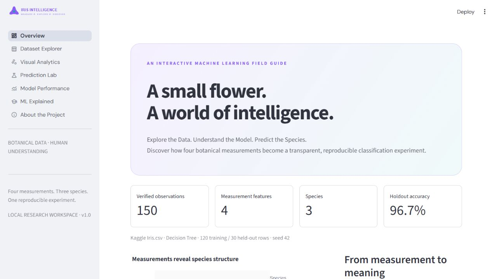
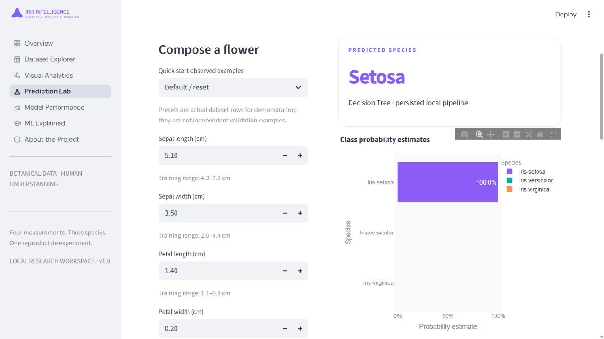

# ✿ IRIS INTELLIGENCE

**Explore the Data. Understand the Model. Predict the Species.**

A complete local Python platform for classifying Iris flowers from four botanical measurements. It combines a reproducible ML experiment, seven Streamlit workspaces, interactive visual analytics, a prediction laboratory, automated tests, and an executed research notebook.

## Verified experiment

The authentic [Kaggle Iris.csv](https://www.kaggle.com/datasets/saurabh00007/iriscsv) was downloaded directly from Kaggle: **150 flowers, 4 measurement features, 3 balanced species**. Acquisition method and SHA-256 are recorded in `data/raw/Iris.provenance.json`.

| Result | Measured value |
|---|---:|
| Selected estimator | Decision Tree |
| Best parameters | max_depth=3, min_samples_leaf=3 |
| Training CV macro F1 | 0.9665 |
| CV fold standard deviation | 0.0488 |
| Held-out accuracy | 96.67% (29/30) |
| Held-out macro F1 | 0.9666 |

These values are from the bundled seed-42 experiment, not guarantees about future flowers. The dashboard reads generated artifacts rather than hardcoded scores. See [the generated report](reports/results.md) and [machine-readable evaluation](reports/metrics/evaluation.json).

## Quick start · Windows 11 / PowerShell

Python **3.11** is the verified runtime. Run from this project folder:

```powershell
py -3.11 -m venv .venv
.\.venv\Scripts\python.exe -m pip install -r requirements.txt
.\.venv\Scripts\python.exe -m src.download
.\.venv\Scripts\python.exe -m src.train
.\.venv\Scripts\python.exe -m pytest -q
.\.venv\Scripts\python.exe -m streamlit run app.py
```

Open **http://localhost:8501**. The current workspace already contains the downloaded CSV, trained pipeline and generated reports; after installation, you can launch the application immediately. Joblib binaries are ignored by Git, so a fresh clone needs training. No activation or PowerShell execution-policy changes are required when using the Python executable directly.

If Kaggle blocks unauthenticated download, download `Iris.csv` from the dataset page and import it explicitly:

```powershell
.\.venv\Scripts\python.exe -m src.download --import-csv "$HOME\Downloads\Iris.csv"
```

An optional installed Kaggle CLI can also use `kaggle datasets download -d saurabh00007/iriscsv -p data/raw --unzip`. Follow [official Kaggle authentication](https://github.com/Kaggle/kaggle-api#authentication); never put credentials in this repository. The application never silently substitutes sklearn's dataset. Sklearn Iris is used only in isolated test fixtures.

## The application

| Workspace | Purpose |
|---|---|
| Overview | Actual metrics, species summaries, workflow and navigation |
| Dataset Explorer | Species and feature filters, table, statistics, integrity audit and filtered CSV export |
| Visual Analytics | Scatter, histogram, box, violin, correlation, pair matrix, PCA and 3D exploration; downloadable HTML charts |
| Prediction Lab | Real observed presets, editable cm inputs, persisted inference, probability estimates, extrapolation warnings, reset, session history, CSV export, nearest training examples and what-if response curves |
| Model Performance | Five-model CV comparison, fold scores, best parameters, holdout metrics, confusion matrices, per-class scores, permutation importance and actual errors |
| ML Explained | Beginner-friendly lessons, workflow diagram and an interactive precision/recall calculator |
| About | Objective, source, methodology, findings, reproducibility, limitations and report downloads |

The original iris vector mark is decorative. The classifier operates on four numbers, never photographs. The layout supports Streamlit light/dark themes and narrow screens. Typography falls back to local system fonts if the optional web font cannot load.

### Genuine application captures




Additional dark-theme and narrow-viewport captures are in `reports/screenshots/`.

## Scientifically honest model development

All five algorithms are implemented: **Logistic Regression, KNN, SVM, Decision Tree and Random Forest**. GridSearchCV compares reasonable predeclared search spaces with macro F1 as the primary selection score. Exact CV ties use accuracy then a fixed simplicity order. Scaled estimators place StandardScaler inside their pipelines; trees use passthrough.

An 80/20 stratified split of unique measurement tuples preserves all observations and prevents repeated measurements crossing train/test boundaries. The authentic CSV has three repeated measurement rows (zero identical full rows because IDs differ). Grouped stratified five-fold CV also prevents these repetitions crossing validation boundaries. Group splitting can make the row ratio slightly different from 80/20; this experiment produced 120/30 rows. Id is excluded. No imputation, arbitrary outlier filtering, row removal or target recoding is performed.

Only training data participates in fitting, tuning and selection. **Only the winner is evaluated on the holdout.** The persisted pipeline remains fitted on the 120 training rows. CV estimates after tuning are optimistic selection estimates, not nested-CV generalization estimates. The holdout is independent of selection. Permutation importance is computed afterward as a descriptive holdout diagnostic, never used to retune the model.

## Layout

```text
app.py                     Streamlit entry point and navigation
requirements.txt           Pinned direct dependencies
.streamlit/config.toml     Theme and local server configuration
assets/                    Original iris identity graphic
components/                Cached resources and reusable presentation
views/                     Seven application workspaces
src/                       Configuration, acquisition, validation,
                           preprocessing, training, evaluation,
                           inference, EDA and report generation
data/raw/                  Authentic CSV and acquisition provenance
data/processed/            Validated dataset export
models/                    Fitted local pipeline and metadata
reports/figures/           Actual PNG figures and interactive HTML
reports/metrics/           Experiment, evaluation, comparison,
                           predictions, errors and importance
reports/results.md         Generated experimental report
reports/screenshots/       Genuine browser captures
output/pdf/                Printable four-page experimental report
notebooks/                 Executed demonstration notebook
scripts/                   Notebook generation/execution utility
docs/                      Methodology, architecture, user/test guides
tests/                     Validation, pipeline and UI tests
```

## Programmatic prediction

```python
from src.predict import load_bundle, predict

model, metadata = load_bundle()
result = predict(model, metadata, {
    "SepalLengthCm": 5.1,
    "SepalWidthCm": 3.5,
    "PetalLengthCm": 1.4,
    "PetalWidthCm": 0.2,
})
print(result["species"])
print(result["probabilities"])
```

Input keys are reordered into the canonical feature sequence; missing/extra keys, booleans, non-numeric, non-finite and non-positive values are rejected. Warnings identify values outside training ranges. Class estimates are not guarantees or independently calibrated confidence.

## Reproduce and inspect

```powershell
.\.venv\Scripts\python.exe -m src.train
.\.venv\Scripts\python.exe -m scripts.notebook
.\.venv\Scripts\python.exe -m pytest -q
.\.venv\Scripts\python.exe -m compileall -q app.py src components views tests scripts
.\.venv\Scripts\python.exe -m pip check
```

The notebook builder executes the full workflow using modular project code and a temporary output directory, so it does not replace the canonical experiment. `--quick` training uses one candidate per estimator for development; it is not the portfolio benchmark.

Read the [Windows user guide](docs/user_guide.md), [methodology](docs/methodology.md), [architecture](docs/architecture.md), [testing guide](docs/testing_guide.md) and [results report](reports/results.md).

A [printable four-page PDF](output/pdf/iris_intelligence_report.pdf) is also included. To regenerate it after training, install the small optional reporting dependency:

```powershell
.\.venv\Scripts\python.exe -m pip install -r requirements-report.txt
.\.venv\Scripts\python.exe -m scripts.pdf_report
```

## Limitations and next steps

A small balanced historical benchmark does not establish reliability for wild flowers, new locations, new species or unusual measurement combinations. The single split has sampling variation. Probability calibration needs independent assessment. Global permutation importance can understate correlated features and is not a local causal explanation. Future work: externally collected data, nested CV, measurement-noise experiments and independent calibration. Markdown is the complete report format; the included PDF provides a concise printable presentation.

## Repository hygiene

The repository defines direct dependency versions, excludes environments, caches, secrets and local joblib binaries, and retains source, provenance and inspectable experimental outputs. `requirements-lock.txt` records the full verified Windows environment. Generated model metadata must be regenerated along with the ignored binary after a fresh clone. No credentials or absolute machine-specific paths are required by application code. No deployment, accounts, database or external service is needed at runtime.
