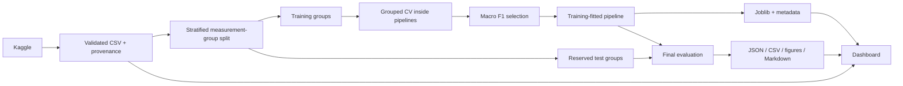

# Architecture

`app.py` owns Streamlit page configuration and explicit navigation to seven `views/` scripts. `components/ui.py` holds presentation helpers; `components/state.py` loads and caches data, model and JSON reports by file modification signatures. Source checksums detect a CSV changed since training. No page trains a model or writes an experiment.

The core `src/` package has no dependency on Streamlit UI behavior. `config.py` resolves the project root from its own file and fixes the feature order, units, labels, colors and seed. `data_loader.py` enforces the CSV contract and exposes audit/feature functions. `download.py` handles public acquisition or manual import. `preprocessing.py` owns grouped splitting and sklearn pipeline creation. `train.py` tunes five candidates and selects without test feedback. `evaluate.py` runs final metrics and post-selection permutation analysis. `predict.py` validates ordered inputs and loads trusted local artifacts. `eda.py` supplies interactive figures and batch static exports; `report.py` writes the report from measured results.

Data flow:

The model binary is local/ignored; reproducible metadata and inspectable results are retained. Retraining regenerates the full model/report set; stop the app while retraining to avoid transient partial-output reads. Caches refresh when file signatures change. Predictions and history stay in the current Streamlit session; there is no database or user authentication. HTML exports embed Plotly so they can be opened offline. Optional web fonts fall back to installed fonts and the logo can be absent without blocking startup.

All model paths are rooted in the project directory rather than a user's absolute machine path. The tested Windows runtime is Python 3.11.9; pinned requirements target Python 3.11. Dependencies include notebook tooling for the executed demonstration. There are no heavyweight deep-learning dependencies or hosted services.
