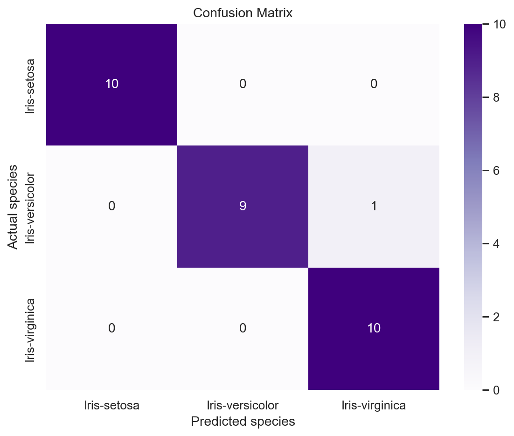
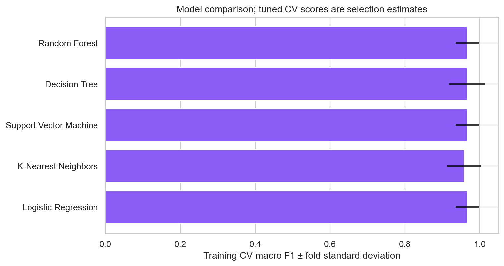
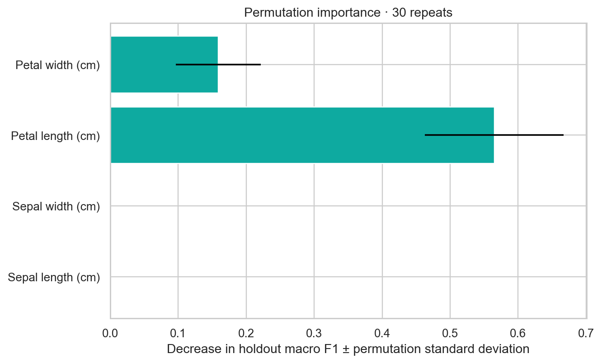

# Iris Intelligence — experimental report

## Abstract
Five classical classifiers were tuned on four numerical Iris flower measurements. The selected Decision Tree achieved 96.67% accuracy and 0.9666 macro F1 on 30 held-out observations. These results describe one small benchmark split, not general botanical reliability.

## Introduction and objective
The supervised task maps sepal length, sepal width, petal length and petal width (cm) to setosa, versicolor or virginica. The objective is a transparent, reproducible classification workflow with an interactive measurement laboratory.

## Dataset and integrity
Source: https://www.kaggle.com/datasets/saurabh00007/iriscsv. Acquisition: direct HTTPS download from official Kaggle dataset API.
CSV SHA-256: `600ac44f23c2e6e0ae37daac8ceb2baba4df963efa580eb31b3b576b28e34c55`. Validation rejects missing columns, unexpected fields, non-finite or non-positive values, invalid IDs and conflicting labels. No observations are removed. Id is excluded from model inputs. Repeated measurements remain together across all train/validation/test boundaries.

## Methodology and experimental setup
Random seed 42; an 80/20 stratified split of unique measurement groups yields 120 training rows and 30 test rows. Grouping can shift the exact row ratio. Five-fold shuffled stratified group CV is used inside GridSearchCV. Logistic regression, KNN and SVM use a StandardScaler inside their pipelines; trees use passthrough. String labels preserve the original species names. All tuning and scaler fitting use training partitions only. The final saved pipeline is fitted on the training partition, not refitted on the full dataset.

## Algorithms and selection
Logistic regression is a regularized linear classifier; KNN uses local distances; SVM uses linear or radial boundaries; a decision tree recursively partitions features; a random forest averages randomized trees. Search spaces and selected parameters are in `metrics/experiment.json`.
Highest training CV macro F1; numerical ties resolved by CV accuracy then fixed simplicity order (linear, neighbors, SVM, tree, forest). Holdout never used for selection.

## Actual model comparison
| Algorithm | CV macro F1 | Fold SD | CV accuracy |
|---|---:|---:|---:|
| Logistic Regression | 0.9663 | 0.0313 | 0.9652 |
| K-Nearest Neighbors | 0.9579 | 0.0458 | 0.9561 |
| Support Vector Machine | 0.9663 | 0.0313 | 0.9652 |
| Decision Tree | 0.9665 | 0.0488 | 0.9644 |
| Random Forest | 0.9663 | 0.0313 | 0.9652 |

Selected model: **Decision Tree**. CV macro F1: **0.9665 ± 0.0488**. The SD measures fold variation, not a confidence interval. Tuned CV estimates are optimistic selection estimates; no nested-CV superiority claim is made.

## Final evaluation
Only the selected model is evaluated on the untouched holdout. Accuracy: **0.9667**; macro precision **0.9697**; macro recall **0.9667**; macro F1 **0.9666**. Weighted precision/recall/F1: **0.9697 / 0.9667 / 0.9666**. Correct: **29**; incorrect: **1**.
Accuracy is the fraction correct; precision concerns predicted positives; recall concerns actual positives; F1 balances precision and recall. Macro averaging weights each class equally. Weighted averaging weights class support.

## Error analysis and discussion
Every test example is in `metrics/test_predictions.csv`; errors are in `metrics/errors.csv`. Misclassified examples are listed in the errors CSV and dashboard; overlapping versicolor and virginica measurements are a plausible explanation, not a proven cause.
Descriptive plots show strong petal-feature separation for setosa and more overlap between versicolor and virginica. Correlated measurements can share predictive information, so permutation importance can understate individual feature relevance. Importance is a global holdout diagnostic; it does not establish a causal explanation of a specific prediction. PCA is a descriptive full-dataset visualization and is never fed into the predictive pipeline.

## Limitations
The dataset is small, balanced and restricted to three species. Scores vary with the split. Probabilities are model estimates, not guarantees; they have not undergone an independent calibration study. SVM probability estimates use internal probability fitting. Predictions outside training feature ranges extrapolate. Nearest training examples provide similarity context, not proof of a decision mechanism. No photographs are analyzed.

## Conclusion
The implementation meets the classification task with validated measurements, training-only selection, an independent evaluation, persisted inference and a reusable dashboard. Future work includes externally collected observations, nested CV and independent probability calibration.

## References
- [Kaggle Iris.csv dataset](https://www.kaggle.com/datasets/saurabh00007/iriscsv)
- [Scikit-learn: common pitfalls and leakage prevention](https://scikit-learn.org/stable/common_pitfalls.html)
- [Scikit-learn: permutation importance](https://scikit-learn.org/stable/modules/permutation_importance.html)
- [Streamlit documentation](https://docs.streamlit.io/)
